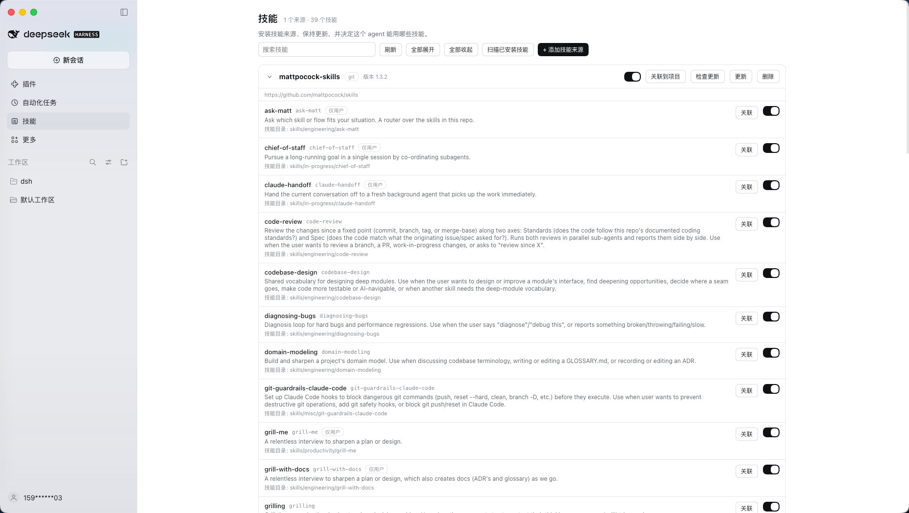
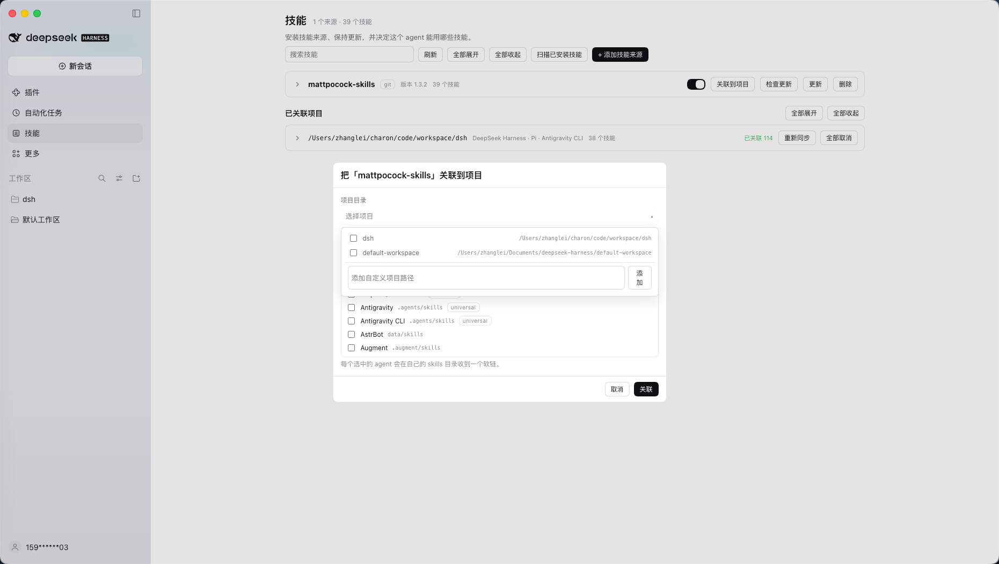
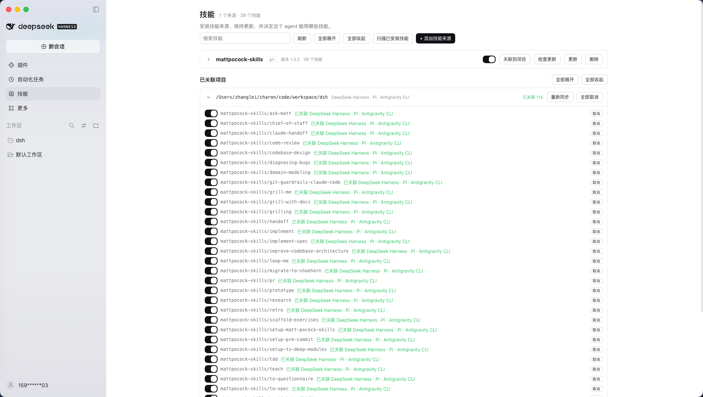
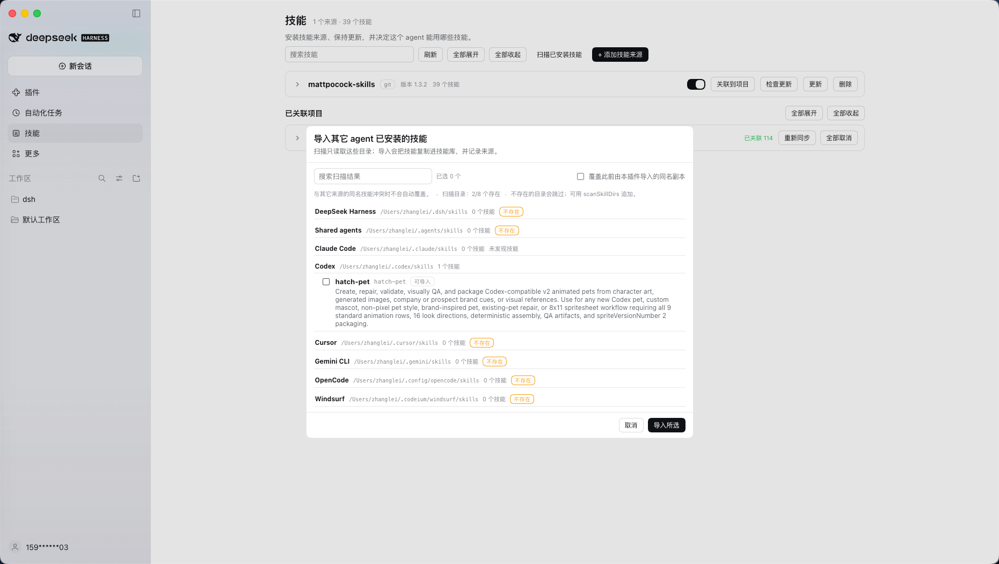
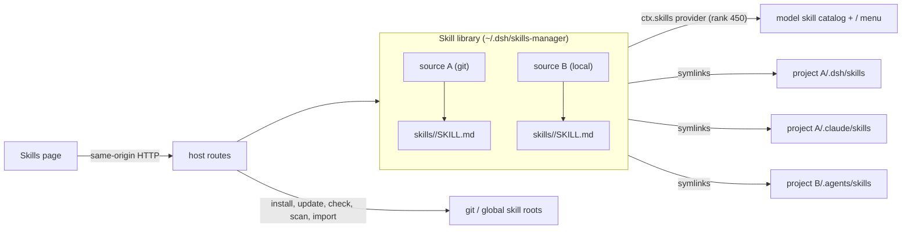

# dsh-skills-manager

English | [中文](README.zh.md)

A **skill library manager for [DeepSeek Harness](https://github.com/deepseek-ai/deepseek-harness)**. Install skill sources from Git or a local folder, keep them current, import skills other agents already installed, and distribute them into projects as symlinks — for DSH itself and for the other coding agents a project uses.

Everything is available on a dedicated **Skills** page in the Harness sidebar, next to Plugins and Automation tasks.



## What it does

- **One library, many sources.** Every source is a Git clone or a copied folder; a source may contain one skill or dozens.
- **Version and update checks.** `package.json` version when present, otherwise `git describe --tags --always --dirty`; **Check for updates** fetches the remote and reports commits behind/ahead, local changes, and the upstream version label. Updating stays an explicit `git pull --ff-only`.
- **Install from anywhere reasonable.** Git (`https://`, `ssh://`, `scp`-like), a local folder, or the scanner for skills already installed by DSH, Claude Code, Codex, Cursor, Gemini CLI, OpenCode, Windsurf and shared agents.
- **Project distribution by symlink.** Link any number of projects at once; each project's agent directories point straight into the library, so one update reaches every project. Choose per project which agents to target (75 conventions plus `dsh`).
- **Two switch levels.** The library switch is the master (disabled skills leave the model catalog and the `/` menu); the per-project switch only controls distribution into that project.
- **Collapsible lists, batch controls.** Source cards and linked projects start collapsed; expand one row, or use Expand all / Collapse all.

## Screenshots

**Link any number of projects and choose the agents to target.** The project field is a multi-select dropdown; a single submit writes every selected project.



**Every linked project keeps its own switches.** Each row shows the state and the agents that hold the link, not file paths.



**Import what other agents installed.** The scanner groups results by origin; missing or empty directories show 0.



## How it works



- The library lives outside every agent's scan path; only explicit links put a skill into a project.
- Skills reach DSH through a dedicated `SkillProvider`, so the model `skill` tool and the `/` menu work without extra wiring.
- Project links are real symlinks into the library; a real file, a directory, or a foreign symlink at the target position is reported as a conflict and never touched.

## Install

Requirements: Node.js ≥ 24.9, DeepSeek Harness `0.2.1-rc.5` or newer (tested on `0.2.1-rc.5` and `0.2.2-alpha.2`), `git` only for Git sources.

As a profile bundle (the published shape). Install from the npm registry:

```sh
dsh plugin --profile skills-test add @charonx/dsh-skills-manager
```

Or from Git (the package builds itself through its `prepare` script):

```sh
dsh plugin --profile skills-test add git+https://github.com/charonX/dsh-skills-manager.git
```

The repository commits its build output (`lib/` and `client/`), so Git installs need no build approval. A GitHub Release tarball works the same way:

```sh
dsh plugin --profile skills-test add https://github.com/charonX/dsh-skills-manager/releases/download/v0.1.1/charonx-dsh-skills-manager-0.1.1.tgz
```

Or pack it yourself:

```sh
npm pack                                                        # build + tarball
dsh --profile skills-test --from-default-profile web --dump-config >/dev/null
dsh plugin --profile skills-test add "$PWD/charonx-dsh-skills-manager-0.1.1.tgz"
dsh --profile skills-test --no-open --port 3099                 # open the token URL
dsh plugin --profile skills-test remove @charonx/dsh-skills-manager
```

The published name is `@charonx/dsh-skills-manager`; the unqualified `dsh-skills-manager` on npm belongs to a different project.

While developing, link the checkout instead of packing (`dsh plugin add "$PWD"`), and select the built entry with an overlay:

```yaml
# dev/overlay.example.yml — replace the absolute paths
- insert:
    - id: skills-manager
      name: '/absolute/path/to/dsh-skills-manager/lib/index.js'
      config:
        libraryDir: /absolute/path/to/dsh-skills-manager/.dev/library
```

Desktop: **Plugins → Add plugin → local path**, then open **Skills** in the sidebar. Exact steps and troubleshooting: [docs/INSTALL.md](docs/INSTALL.md).

## Use

**Sources** — add a Git repository or a local folder. Local folders are copied without their `.git`; Git installs stream `git clone` output. Removing a source deletes its directory and records, and removes every project link first.

**Version and updates** — the source card shows the version and, for Git, a **Check for updates** result (`N new commits`, local changes, last check time). **Update** runs `git pull --ff-only`; a failure keeps the raw Git output.

**Link to a project** — the project field is a multi-select dropdown: pick workspace directories or add custom paths, choose agents (`dsh` by default), then submit once for every selected project. A linked skill is visible in that project's sessions (`project-dsh`, rank 100) and in the other chosen agents' directories.

**Linked projects** — each project row lists its skills with a per-project switch and the state plus agent names (`linked dsh · claude-code`). **Resync** restores deleted links, repairs hand-repointed library links, and drops broken ones and stale records. **Unlink all** removes the links and the record.

**Scan installed skills** — the scanner reads existing global roots (`~/.dsh/skills`, `~/.agents/skills`, `~/.claude/skills`, `~/.codex/skills`, `~/.cursor/skills`, `~/.gemini/skills`, `~/.config/opencode/skills`, `~/.codeium/windsurf/skills`, plus `scanSkillDirs`) and groups results by origin. Roots that are missing or empty show **0**, so it is obvious what was scanned. Import copies the selected skills into `imported-<origin>` sources.

### Import strategy and conflicts

Importing **copies**; it never symlinks to the original directory. External directories do not belong to this manager, so a link would hand their lifecycle to another tool. Conflicts are decided by skill name plus the sha256 of `SKILL.md`:

| Situation | Behavior |
|---|---|
| Same name, same content | Skipped as already imported |
| Same name, different content, library copy is local/Git-managed | Refused (`SKILL_NAME_CONFLICT`) |
| Same name, different content, library copy is an earlier import | Refused by default; **overwrite** replaces only that imported copy |
| Path outside the configured roots, or empty selection | Failed (`IMPORT_PATH_INVALID`, `IMPORT_EMPTY`) |

Provenance (`originPath`, `originRoot`, `contentHash`, `importedAt`) is recorded in `imports.json`.

## Configuration

```yaml
- id: skills-manager
  name: '@charonx/dsh-skills-manager'
  config:
    libraryDir: ~/.dsh/skills-manager/library            # default
    statePath: ~/.dsh/skills-manager/manager-state.json  # default
    linksPath: ~/.dsh/skills-manager/links.json          # default
    updatesPath: ~/.dsh/skills-manager/updates.json      # default
    importsPath: ~/.dsh/skills-manager/imports.json      # default
    scanSkillDirs: []                                    # extra global roots
    providerName: skills-manager
    rank: 450
    routePrefix: /dsh-skills-manager
    allowFileProtocol: true
```

| Field | Meaning |
|---|---|
| `libraryDir` | Managed library root; every direct child is a source |
| `statePath` | Enable flags, categories, notes (sparse JSON) |
| `linksPath` | Per-project link intent (agents + skills) |
| `updatesPath` | Last Git update check per source |
| `importsPath` | Provenance of imported skills |
| `scanSkillDirs` | Extra roots offered by the import scanner |
| `providerName` / `rank` | Provider registration; rank 450 sits between project skills (100/200) and user roots (500) |
| `routePrefix` | HTTP prefix for the Web Client |
| `allowFileProtocol` | Accept `file://` Git identifiers |

## HTTP API

All routes live under `routePrefix`; responses are JSON with `cache-control: no-store`.

| Method | Path | Purpose |
|---|---|---|
| `GET` | `/api/library` | Sources, skills, enable flags, update checks, problems |
| `POST` | `/api/sources/install` | `{ sourceType: 'git' \| 'local', identifier, force? }` → `202 { jobId }` |
| `GET` | `/api/jobs/:jobId` | Job state and accumulated command output |
| `POST` | `/api/sources/:slug/check` | Fetch and compare with upstream → `{ check }` |
| `POST` | `/api/sources/:slug/update` | `git pull --ff-only` → `202 { jobId }` |
| `DELETE` | `/api/sources/:slug` | Remove source, links, records |
| `PUT` | `/api/sources/:slug` | `{ enabled?, category?, note? }` |
| `PUT` | `/api/sources/:slug/skills/:skill` | `{ enabled?, note? }` |
| `GET` | `/api/agents` | Agent directory registry |
| `GET` | `/api/projects` | DSH workspaces as link targets |
| `GET` | `/api/links` | Recorded projects with refreshed state |
| `POST` | `/api/links` | `{ project, source, skillName?, agents? }` |
| `PUT` | `/api/links` | `{ project, source, skillName?, enabled }` per-project switch |
| `DELETE` | `/api/links` | Same body → unlink and drop the record |
| `POST` | `/api/links/resync` | `{ project }` → repair |
| `GET` | `/api/scan` | Scan global roots, grouped by origin |
| `POST` | `/api/import` | `{ paths, overwrite? }` → import outcomes |

Errors use `{ "error": { "code", "message" } }` with codes such as `SKILL_SOURCE_INVALID`, `SKILL_SLUG_CONFLICT`, `SKILL_FETCH_FAILED`, `SKILL_UPDATE_FAILED`, `PROJECT_INVALID`, `AGENT_INVALID`, `SKILL_NAME_CONFLICT`, `IMPORT_PATH_INVALID`, `GIT_UNAVAILABLE`, `UNTRUSTED_REQUEST`.

## Security

- Mutating requests must be same-origin: a loopback or declared `trustedHosts` authority, no `cross-site` fetch metadata, and a matching `Origin` when one is present.
- Git identifiers are restricted to non-executable transports; `ext::` and option-shaped values are rejected before any process starts.
- No shell: every child process is spawned with an argument array, and `--` ends Git option parsing.
- Slugs and skill names must be single directory names; composed paths are checked to stay inside the library. Project links only remove symlinks that resolve into the library.
- Import only accepts paths inside the configured scan roots.

## Development

```sh
pnpm install
pnpm run typecheck          # host, client, and tests
pnpm test                   # 88 unit/integration tests (real git, symlinks, registry, HTTP)
pnpm run build              # tsc → lib/, tsdown → client/client.js
pnpm run smoke:client       # load the built bundle and assert its registrations
pnpm verify:local           # boot a real dsh web with an isolated overlay (8 checks)
pnpm verify:profile         # pack, install into an isolated profile, boot it (9 checks)
pnpm verify:profile -- --linked
```

Debugging (DevTools, `curl`, optional Playwright replay): [docs/DEBUG.md](docs/DEBUG.md). Verification matrix: [docs/VERIFY.md](docs/VERIFY.md). Design and phase plan: [docs/DESIGN.md](docs/DESIGN.md).

## Known limitations

- No filesystem watcher: changes made outside the UI appear on the next manager operation or restart.
- Categories and notes are stored and exposed by the API but not edited in the page yet.
- Global (user-level) distribution to other agents is not implemented; links are project-scoped. DSH itself sees the library globally through the provider.
- Re-enabling a disabled skill or source does not restore links automatically; use **Resync** on the project.
- The Desktop shell (`dsh-app://`) is verified manually; automated checks cover `dsh web`.
- Harness plugin APIs are pre-stable; `engines.dsh` pins the tested range.

## Credits

The agent directory snapshot in `src/agent-registry.ts` derives from the registry in [`vercel-labs/skills`](https://github.com/vercel-labs/skills) v1.5.20 (MIT), plus one local `dsh` row. Only the data is used — install, linking, repair, and import are implemented here. See [THIRD_PARTY_NOTICES.md](THIRD_PARTY_NOTICES.md).
