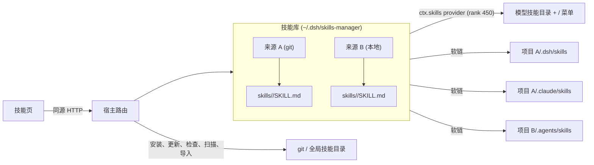

# dsh-skills-manager

[](https://www.npmjs.com/package/@charonx/dsh-skills-manager) [](https://github.com/charonX/dsh-skills-manager/blob/main/LICENSE)

[English](https://github.com/charonX/dsh-skills-manager/blob/main/README.md) | 中文

面向 [DeepSeek Harness](https://github.com/deepseek-ai/deepseek-harness) 的**技能库管理器**：从 Git 或本地目录安装技能来源、保持更新、导入其它 agent 已安装的技能，并以软链方式分发到项目——同时服务 DSH 本身和项目里使用的其它编码 agent。

入口在 Harness 左侧栏独立的 **技能** 页，与「插件」「自动化任务」并列。


## 能力

- **一个技能库，多个来源**：每个来源是一份 Git clone 或拷贝的目录，里面可以有一个或几十个技能。
- **版本与更新检查**：优先 `package.json` 的版本，否则 `git describe --tags --always --dirty`；「检查更新」会 fetch 远端并报告落后/领先提交数、本地改动和远端版本标签；更新仍是显式的 `git pull --ff-only`。
- **多种安装方式**：Git（`https://`、`ssh://`、`scp` 形式）、本地目录，或扫描 DSH、Claude Code、Codex、Cursor、Gemini CLI、OpenCode、Windsurf 及共享 agent 的全局目录。
- **按项目软链分发**：一次可关联多个项目；项目的 agent 目录直接指向技能库，库更新一次即全项目生效。每个项目可勾选目标 agent（75 种约定 + `dsh`）。
- **两层开关**：库开关是总闸（停用即移出模型 catalog 与 `/` 菜单）；项目开关只控制是否分发到该项目。
- **列表可收起，支持批量**：来源卡片与已关联项目默认收起，可单行展开，也可「全部展开/全部收起」。

## 截图

**一次关联多个项目，并选择目标 agent。** 项目字段是多选下拉，点一次「关联」写入所有选中项目。


**每个已关联项目有自己的开关。** 条目显示状态与持有链接的 agent 名，不显示文件路径。


**导入其它 agent 已安装的技能。** 扫描结果按来源分组，不存在或空的目录显示 0。


## 工作原理



- 技能库位于所有 agent 扫描路径之外；只有显式关联才会把技能放进某个项目。
- 技能通过专用 `SkillProvider` 进入 DSH，因此模型 `skill` 工具和 `/` 菜单无需额外接线。
- 项目关联是真正指向库的软链；目标位置若是真实文件、目录或外部软链，会报冲突且绝不修改。

## 安装

要求：Node.js ≥ 24.9；DeepSeek Harness `0.2.1-rc.5` 及以上（在 `0.2.1-rc.5` 与 `0.2.2-alpha.2` 上验证）；只有 Git 来源需要 `git`。

以 profile bundle 安装（发布形态）。从 npm 安装：

```sh
dsh plugin --profile skills-test add @charonx/dsh-skills-manager
```

或直接从 Git 安装（包内 `prepare` 会自行构建）：

```sh
dsh plugin --profile skills-test add git+https://github.com/charonX/dsh-skills-manager.git
```

仓库已提交构建产物（`lib/`、`client/`），Git 安装不需要构建授权。GitHub Release 的 tarball 同样免构建：

```sh
dsh plugin --profile skills-test add https://github.com/charonX/dsh-skills-manager/releases/download/v0.1.1/charonx-dsh-skills-manager-0.1.1.tgz
```

或自行打包：

```sh
npm pack                                                        # 构建并打包
dsh --profile skills-test --from-default-profile web --dump-config >/dev/null
dsh plugin --profile skills-test add "$PWD/charonx-dsh-skills-manager-0.1.1.tgz"
dsh --profile skills-test --no-open --port 3099                 # 打开日志里的 token 地址
dsh plugin --profile skills-test remove @charonx/dsh-skills-manager
```

发布名为 `@charonx/dsh-skills-manager`；npm 上无前缀的 `dsh-skills-manager` 属于另一个项目。

开发时用 linked checkout 更快（`dsh plugin add "$PWD"`），或用 overlay 直接挂源码行：

```yaml
# dev/overlay.example.yml —— 替换绝对路径
- insert:
    - id: skills-manager
      name: '/absolute/path/to/dsh-skills-manager/lib/index.js'
      config:
        libraryDir: /absolute/path/to/dsh-skills-manager/.dev/library
```

Desktop：**Plugins → Add plugin → 本地路径**，然后在左栏打开 **技能**。完整步骤与排错见 [docs/INSTALL.md](https://github.com/charonX/dsh-skills-manager/blob/main/docs/INSTALL.md)。

## 使用

**来源** —— 添加 Git 仓库或本地目录。本地目录会被拷贝（不含 `.git`），Git 安装会实时输出 `git clone` 日志。删除来源会先清掉所有项目软链，再删目录与记录。

**版本与更新** —— 来源卡片显示版本；Git 来源可「检查更新」，显示 `有 N 个新提交`、本地改动与检查时间。「更新」执行 `git pull --ff-only`，失败会保留原始 git 输出。

**关联到项目** —— 项目字段是多选下拉：勾选工作区或添加自定义路径，选择目标 agent（默认 `dsh`），一次提交即可写入所有选中项目。关联后的技能对项目会话可见（`project-dsh`，rank 100），也会出现在所选其它 agent 的目录里。

**已关联项目** —— 每个项目列出技能、项目开关、状态与 agent 名（如 `已关联 dsh · claude-code`）。**重新同步**会补回被删的链、修复被手工改指的库内链、清理断链与失效记录；**全部取消**会删链并删记录。

**扫描已安装技能** —— 扫描器读取已存在的全局目录（`~/.dsh/skills`、`~/.agents/skills`、`~/.claude/skills`、`~/.codex/skills`、`~/.cursor/skills`、`~/.gemini/skills`、`~/.config/opencode/skills`、`~/.codeium/windsurf/skills`，以及 `scanSkillDirs`），按来源分组展示；不存在或空的目录显示 **0**，方便确认扫过哪些位置。导入会把选中的技能复制进 `imported-<来源>`。

### 导入策略与冲突

导入是**复制**，绝不软链到原目录：外部目录不归本插件管理，软链等于把生命周期交给原工具。冲突按技能名 + `SKILL.md` 的 sha256 判定：

| 情况 | 行为 |
|---|---|
| 同名、内容相同 | 跳过（已导入） |
| 同名、内容不同，且库内是本地/Git 管理的技能 | 拒绝（`SKILL_NAME_CONFLICT`） |
| 同名、内容不同，且库内是此前的导入副本 | 默认拒绝；勾选「覆盖」才只替换那份导入副本 |
| 路径不在配置的扫描根内，或没有选择 | 失败（`IMPORT_PATH_INVALID`、`IMPORT_EMPTY`） |

来源信息（`originPath`、`originRoot`、`contentHash`、`importedAt`）记录在 `imports.json`。

## 配置

```yaml
- id: skills-manager
  name: '@charonx/dsh-skills-manager'
  config:
    libraryDir: ~/.dsh/skills-manager/library            # 默认
    statePath: ~/.dsh/skills-manager/manager-state.json  # 默认
    linksPath: ~/.dsh/skills-manager/links.json          # 默认
    updatesPath: ~/.dsh/skills-manager/updates.json      # 默认
    importsPath: ~/.dsh/skills-manager/imports.json      # 默认
    scanSkillDirs: []                                    # 额外全局扫描根
    providerName: skills-manager
    rank: 450
    routePrefix: /dsh-skills-manager
    allowFileProtocol: true
```

| 字段 | 含义 |
|---|---|
| `libraryDir` | 技能库根目录；每个直接子目录是一个来源 |
| `statePath` | 启停、分类、备注（稀疏 JSON） |
| `linksPath` | 项目关联意图（agent + 技能） |
| `updatesPath` | 每个来源的最后一次更新检查 |
| `importsPath` | 导入技能的来源记录 |
| `scanSkillDirs` | 扫描器额外提供的全局根 |
| `providerName` / `rank` | provider 注册；rank 450 位于项目技能（100/200）与用户根（500）之间 |
| `routePrefix` | Web 客户端使用的 HTTP 前缀 |
| `allowFileProtocol` | 是否接受 `file://` Git 标识符 |

## HTTP API

全部位于 `routePrefix` 下，返回 JSON、`cache-control: no-store`。

| 方法 | 路径 | 作用 |
|---|---|---|
| `GET` | `/api/library` | 来源、技能、启停、更新检查、问题 |
| `POST` | `/api/sources/install` | `{ sourceType: 'git' \| 'local', identifier, force? }` → `202 { jobId }` |
| `GET` | `/api/jobs/:jobId` | job 状态与累计命令输出 |
| `POST` | `/api/sources/:slug/check` | fetch 并与上游比较 → `{ check }` |
| `POST` | `/api/sources/:slug/update` | `git pull --ff-only` → `202 { jobId }` |
| `DELETE` | `/api/sources/:slug` | 删除来源、软链与记录 |
| `PUT` | `/api/sources/:slug` | `{ enabled?, category?, note? }` |
| `PUT` | `/api/sources/:slug/skills/:skill` | `{ enabled?, note? }` |
| `GET` | `/api/agents` | agent 目录约定 |
| `GET` | `/api/projects` | DSH 工作区（关联目标） |
| `GET` | `/api/links` | 已记录项目及其最新状态 |
| `POST` | `/api/links` | `{ project, source, skillName?, agents? }` |
| `PUT` | `/api/links` | `{ project, source, skillName?, enabled }` 项目开关 |
| `DELETE` | `/api/links` | 同上 body → 取消关联并删记录 |
| `POST` | `/api/links/resync` | `{ project }` → 修复 |
| `GET` | `/api/scan` | 扫描全局根，按来源分组 |
| `POST` | `/api/import` | `{ paths, overwrite? }` → 导入结果 |

错误形状为 `{ "error": { "code", "message" } }`，常见 code：`SKILL_SOURCE_INVALID`、`SKILL_SLUG_CONFLICT`、`SKILL_FETCH_FAILED`、`SKILL_UPDATE_FAILED`、`PROJECT_INVALID`、`AGENT_INVALID`、`SKILL_NAME_CONFLICT`、`IMPORT_PATH_INVALID`、`GIT_UNAVAILABLE`、`UNTRUSTED_REQUEST`。

## 安全

- 写操作必须同源：Host 为 loopback 或已声明的 `trustedHosts`，不允许 `cross-site`，带 `Origin` 时必须匹配。
- Git 标识符只允许不可执行的传输；`ext::` 与以 `-` 开头的值在任何进程启动前拒绝。
- 不经过 shell：所有子进程用参数数组启动，`--` 终止 Git 选项解析。
- slug / 技能名必须是单个目录名；拼接路径必须仍在库内。项目软链只删除解析到库内的链接。
- 导入只接受配置扫描根内的路径。

## 开发

```sh
pnpm install
pnpm run typecheck          # host、client、tests 三套
pnpm test                   # 88 项单测/集成（真实 git、软链、registry、HTTP）
pnpm run build              # tsc → lib/，tsdown → client/client.js
pnpm run smoke:client       # 加载产物并断言注册形状
pnpm verify:local           # 隔离 overlay 启动真实 dsh web（8 项）
pnpm verify:profile         # 打包、装进隔离 profile、启动（9 项）
pnpm verify:profile -- --linked
```

调试（DevTools、`curl`、可选 Playwright 重放）见 [docs/DEBUG.md](https://github.com/charonX/dsh-skills-manager/blob/main/docs/DEBUG.md)；验证矩阵见 [docs/VERIFY.md](https://github.com/charonX/dsh-skills-manager/blob/main/docs/VERIFY.md)；方案与阶段见 [docs/DESIGN.md](https://github.com/charonX/dsh-skills-manager/blob/main/docs/DESIGN.md)。

## 已知限制

- 没有文件监听：UI 外的改动要到下一次管理操作或重启才可见。
- 分类与备注已存储且 API 可用，但页面暂未提供编辑。
- 其它 agent 的**全局**（用户级）分发未实现；软链是项目级。DSH 自身通过 provider 全局可见。
- 重新启用已停用的技能/来源不会自动恢复软链，需要对该项目点「重新同步」。
- Desktop（`dsh-app://`）为人工验证，自动化覆盖 `dsh web`。
- Harness 插件 API 仍是 pre-stable，`engines.dsh` 固定了验证过的范围。

## 致谢

`src/agent-registry.ts` 中的 agent 目录快照来自 [`vercel-labs/skills`](https://github.com/vercel-labs/skills) v1.5.20（MIT），外加一行本地 `dsh`。只使用数据：安装、建链、修复、导入均由本仓库实现。详见 [THIRD_PARTY_NOTICES.md](https://github.com/charonX/dsh-skills-manager/blob/main/THIRD_PARTY_NOTICES.md)。
